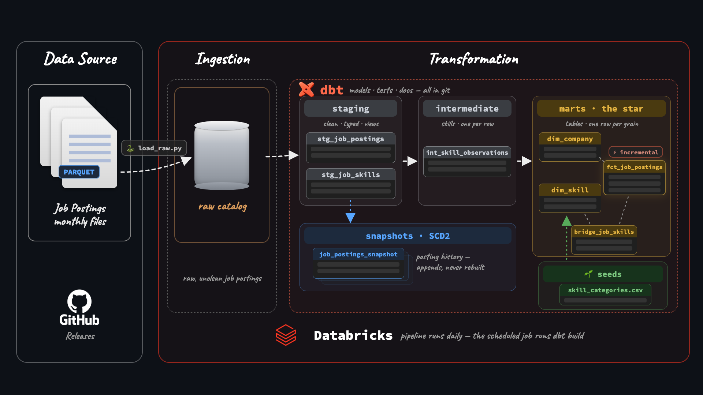

# Production Job Postings Pipeline (v2) - dbt + Databricks



A production **dbt** pipeline on **Databricks** that transforms 843K+ raw job postings into a star schema and tracks historical salary changes—rebuilt nightly with zero stored secrets.

## Key Highlights

- **Star Schema Marts:** Shapes medallion layers (`raw` → `staging` → `intermediate` → `marts`) into **491,140** deduplicated jobs ([`analytics/models/marts/`](analytics/models/marts/)).
- **SCD2 History Tracking:** Captures **504,591** version rows across 13 watched columns to track job edits and salary changes ([`analytics/snapshots/`](analytics/snapshots/)).
- **Incremental Loads:** Merges new daily records on `job_id` using a `search_date` watermark ([`fct_job_postings.sql`](analytics/models/marts/fct_job_postings.sql)).
- **Data Quality & Macros:** Enforces schema, singular, and custom tests alongside reusable Jinja macros ([`analytics/macros/`](analytics/macros/), [`analytics/tests/`](analytics/tests/)).
- **Zero-Secret Orchestration:** Nightly Databricks Job pulls from GitHub, generates temporary warehouse credentials, and promotes data from `dev` to `prod` catalogs.

## Pipeline Lineage


## Quickstart

**Prerequisites:** A Databricks workspace (Free Edition works) with raw job postings loaded into a `raw` catalog.

```bash
uv sync && source .venv/bin/activate     # Set up environment
dbt deps                                 # Install dbt packages
dbt debug                                # Verify Databricks connection
dbt build                                # Run models, seeds, and tests
dbt snapshot                             # Run SCD2 history snapshot
```

> **Optional Backfill:** Run [`scripts/backfill_job_postings_snapshot.sql`](scripts/backfill_job_postings_snapshot.sql) in the Databricks SQL editor to seed a full year of historical snapshots before running `dbt snapshot`.

## Documentation & Analyses


* **Live dbt Docs:** [suwandidwis.github.io/dbt-databricks-pipeline](https://suwandidwis.github.io/dbt-databricks-pipeline/) (also synced to Unity Catalog via `persist_docs`)